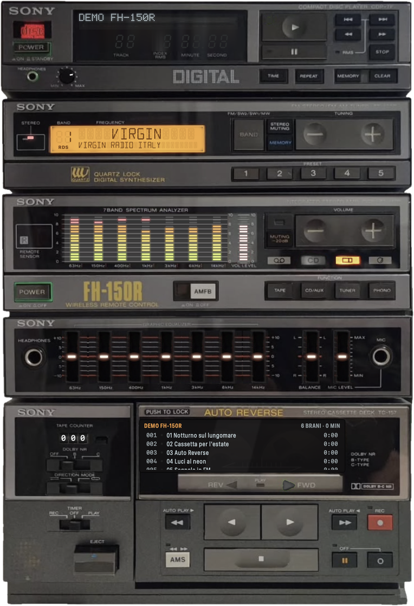

  

<h1 align="center">FH-150R Tribute per macOS</h1>

<b>Lettore MP3, web radio e registratore con l'aspetto di un impianto hi-fi del 1987.</b> 
<i>An MP3 player, web radio and recorder for macOS that looks and works like a 1987 hi-fi stack.</i>

  <a href="https://github.com/luciovirzi-lgtm/sonyfh150r-releases/releases/latest/download/Sony-FH150R.dmg"><b>⬇︎ Scarica l'ultima versione (.dmg)</b></a>
  &nbsp;·&nbsp;
  <a href="https://github.com/luciovirzi-lgtm/sonyfh150r-releases/releases/latest">Note di rilascio</a>

---

La finestra dell'app **è** la fotografia dell'impianto: ogni tasto, manopola e cursore funziona davvero, e display, LED e spie si accendono come sull'originale.

## Cosa fa

- **Lettore CD** — i tuoi MP3, senza pause tra un brano e l'altro; display fluorescente con titolo, artista e tempo; shuffle e ripetizione.
- **Tuner** — migliaia di **radio via internet** (anche Radio Deejay, Rai, RTL, Virgin…); ricerca per nome, 10 preset, display **RDS** con nome della stazione, genere e titolo in onda.
- **Amplificatore** — analizzatore di spettro a 7 bande, volume, muting e **AMFB** per bassi più profondi.
- **Equalizzatore** grafico a 7 bande con preset (Rock, Pop, Jazz, Classica…).
- **Piastra a cassette** — le playlist appaiono nella finestra della cassetta, con le bobine che girano; tasto **REC** per **registrare la radio in MP3**.
- **Modalità mini** — clic sul POWER del lettore CD: l'impianto sparisce e resta solo una voce nella barra dei menu con ▶/■ e il titolo in ascolto.
- **Trascina e ascolta** — un MP3 trascinato sulla finestra o sull'icona nel Dock (o aperto con *Apri con*) parte subito sul lettore CD.
- **Manuale** completo dentro l'app: clic sulla scritta dorata **FH-150R**.
- …e una sorpresa nascosta da qualche parte sul pannello. 😉

## Installazione

1. **Scarica** [`Sony-FH150R.dmg`](https://github.com/luciovirzi-lgtm/sonyfh150r-releases/releases/latest/download/Sony-FH150R.dmg) e aprilo.
2. **Trascina** *FH-150R Tribute* nella cartella **Applicazioni**.
3. **Primo avvio:** l'app non è firmata con un certificato Apple, quindi macOS la blocca la prima volta.
   - **macOS 15 Sequoia e successivi:** prova ad aprire l'app, poi vai in *Impostazioni di Sistema › Privacy e sicurezza*, scorri in basso e premi **Apri comunque**.
   - **macOS 13–14:** *clic destro sull'app › Apri › Apri*.

   Serve solo la prima volta. Per aggiornare, scarica la nuova versione e sostituisci l'app: playlist e impostazioni restano. Se avevi la 1.0.3 o precedenti (si chiamava *Sony FH 150R*), sposta la vecchia app nel Cestino.

**Requisiti:** macOS 13 Ventura o successivo · Mac Intel o Apple Silicon · connessione a internet per la radio.

## Primi passi

| Per… | Fai così |
|---|---|
| Ascoltare i tuoi MP3 | **EJECT** sulla piastra → scegli una cartella → **play** |
| Ascoltare la radio | **TUNER** sull'amplificatore, poi i tasti **PRESET 1–5** |
| Cercare una stazione | clic sul display ambra del tuner |
| Registrare la radio | **REC** sulla piastra; di nuovo **REC** per salvare in *Musica › FH150R Registrazioni* |
| Ridurre alla barra dei menu | **POWER** del lettore CD (in alto a sinistra); *Mostra impianto* per tornare |
| Chiudere l'app | doppio clic sul **POWER** dell'amplificatore |

## Privacy

L'app non raccoglie dati. Per cercare le stazioni invia solo il testo della ricerca all'archivio pubblico [Radio Browser](https://www.radio-browser.info); l'audio arriva direttamente dalle emittenti.

## Note legali

Progetto amatoriale e gratuito, **non affiliato né approvato da Sony**. Sony e FH-150R sono marchi dei rispettivi proprietari; il nome del modello è citato solo per indicare l'impianto a cui l'app rende omaggio. La fotografia dell'impianto appartiene al suo autore.
L'app include l'encoder MP3 [LAME](https://lame.sourceforge.io) (GNU LGPL) come libreria separata e sostituibile; testo della licenza e istruzioni sono nella cartella *Licenze* del file `.dmg`.
Le registrazioni sono per uso personale: rispetta i diritti delle emittenti e degli autori.
